# 🎮 Horizon Education — AI Teaching Game

> Design and Development of an Educational AI Game  
> Academic Year: 2025 / 2026  
> By **Ranym Moussa** — Private Higher Polytechnic School of Monastir  
> Defended on 18/07/2026 before the jury:  
> President: Mme Emna Hkiri · Examiner: Dr. Mohamed Amine Omrani  
> Supervisor: Mr. Mohamed Manaa · Industrial Supervisor: Mr. Yassine Aloui

---

## 📌 Overview

An **AI curriculum disguised as a game** for children aged **6–12**. Seven mini-games teach the full AI development pipeline — from raw data to an autonomous decision — without requiring any coding or math knowledge.

Built in partnership with **Horizon Education**, a Tunisian startup founded in 2020 (Sousse), specializing in educational games and the mobile app *Ferid around the world*.

---

## 🧠 The AI Pipeline (What the Child Walks Through)

| # | Mini-Game | AI Concept Taught |
|---|-----------|-------------------|
| 1 | 🐾 **Animal Sorting** | Data Gathering — *"garbage in, garbage out"* |
| 2 | 🧹 **Object Sorting** | Data Cleaning — handling noisy / mislabeled data |
| 3 | 🤖 **Image Recognition Evaluation** | Model Evaluation — judging predictions against ground truth |
| 4 | 👁️ **Face Detection** | Object Localization — finding items before analyzing them |
| 5 | 🔍 **AI Agent Debugging** | Auditing — catching silent failures, recall > precision |
| 6 | 🤖 **Robot Path Planning** | Planning — action sequences under constraints |
| 7 | 🃏 **AI Decision Making** | Context-aware action selection (policy functions) |

**Progression model:** A central animated drone travels a fixed world map — finishing a mini-game unlocks the next stop, progress is saved across sessions.

---

## 🎙️ Voice Command Recognition

A **CNN-based offline speech recognizer** integrated into *Robot Path Planning* — spoken commands replace drag-and-drop block movement.

- **Task:** 6-class classification — `up` · `down` · `left` · `right` · `unknown` · `silence`
- **Dataset:** Google Speech Commands v0.02 (thousands of single-word recordings, many speakers)
- **Why CNN?** Excellent for keyword spotting, fast real-time inference, suitable for small datasets, low computational cost
- **Deployment:** Trained model runs offline, inside the Unity game

---

## 🛠️ Technology Stack

| Layer | Technology |
|-------|-----------|
| Game engine | Unity |
| Programming | C# |
| Voice model training | Python (CNN) |
| Offline inference | ONNX / embedded model in Unity |
| Graphics | Unity sprite editor |
| Version control | Git |

---

## 📁 Repository Contents

- `Assets/` — Game scenes, prefabs, sprites, scripts
- `Assets/game tut/` — Game tutorial manager, character art, UI sprites
- `Assets/ArabicSupport/` — RTL text rendering support (Arabic)
- `ProjectSettings/` — Unity project configuration
- `README_images/` — Screenshots & visuals for this README

---

## 🎮 Mini-Game Gameplay (GIFs)

| Mini-Game 1 — Data Gathering | Mini-Game 2 — Data Cleaning | Mini-Game 3 — Model Evaluation |
|---|---|---|
| 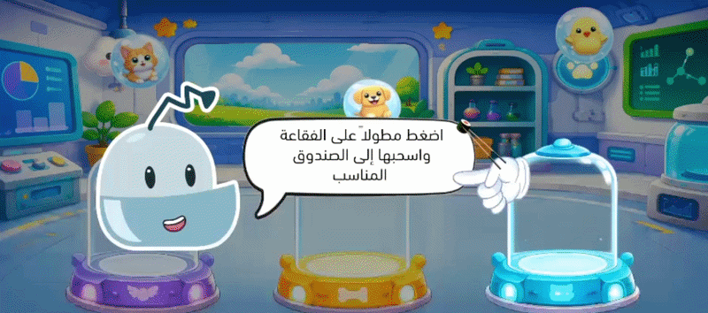 | 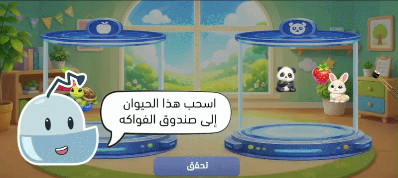 | 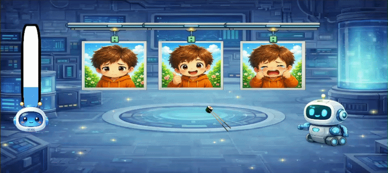 |

| Mini-Game 4 — Face Detection | Mini-Game 5 — AI Debugging | Mini-Game 6 — Path Planning |
|---|---|---|
| 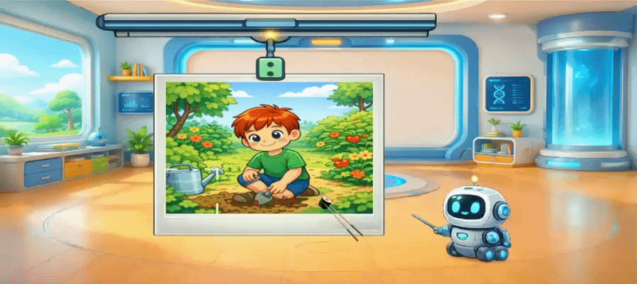 | 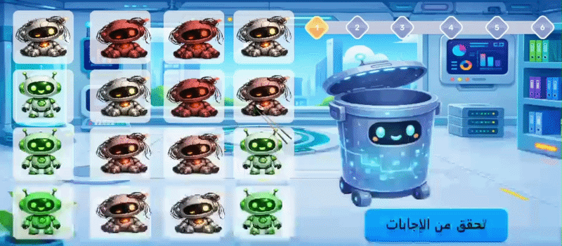 | 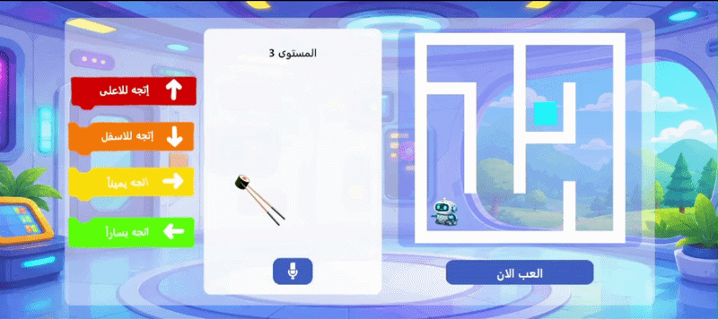 |

| Mini-Game 7 — Decision Making | Game Map |
|---|---|
| 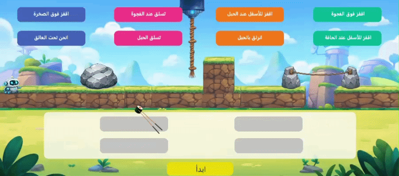 | 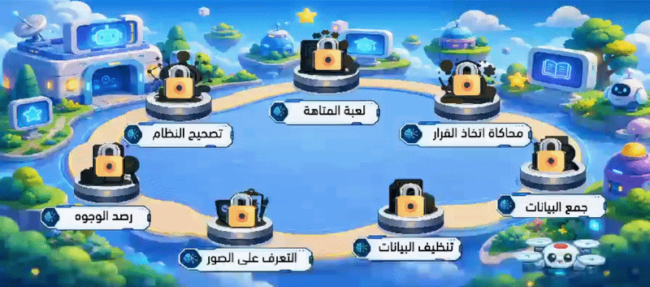 |

---

## 🖼️ Presentation Slides

| Slide | Slide | Slide |
|-------|-------|-------|
| 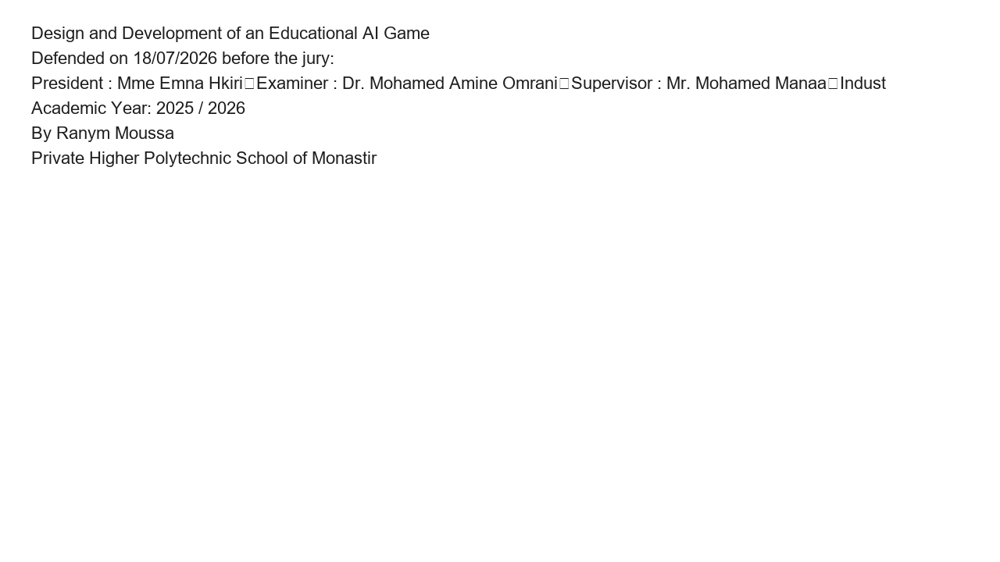 | 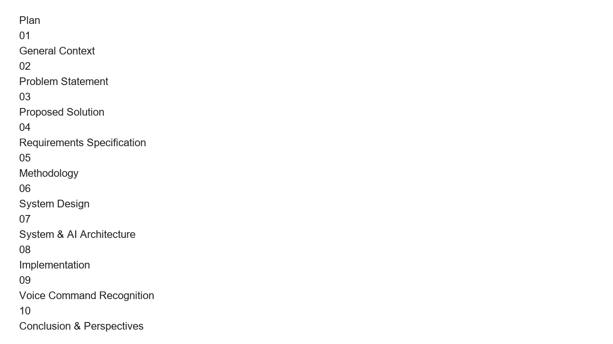 | 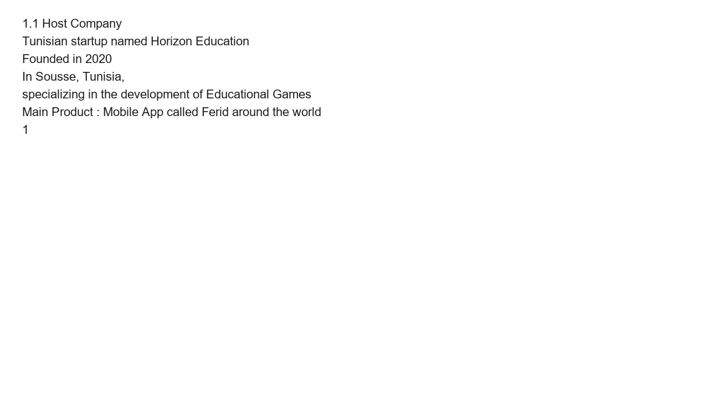 |
| 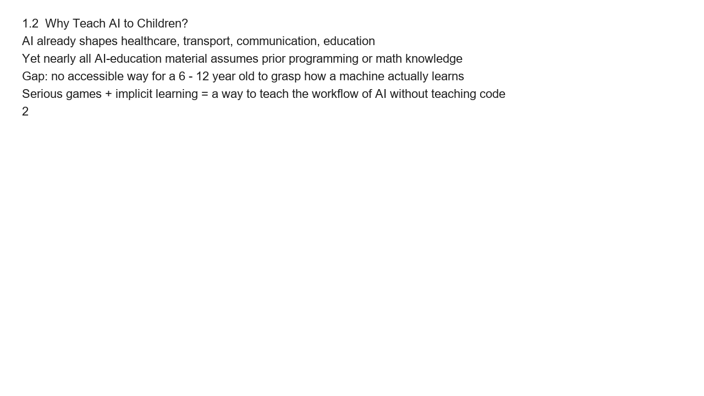 | 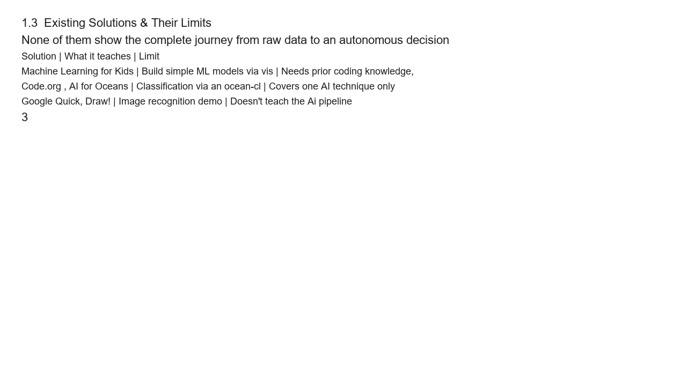 | 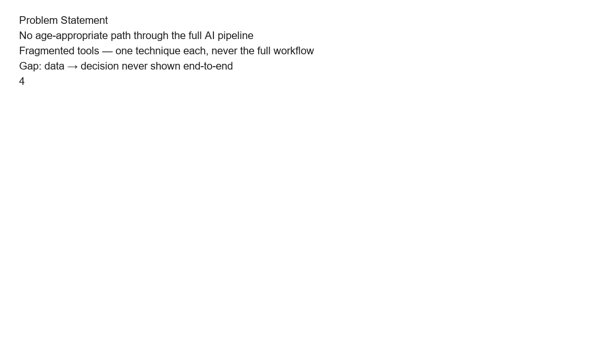 |
| 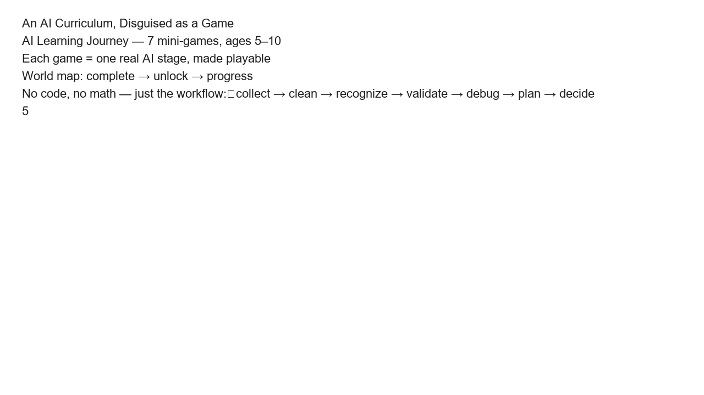 | 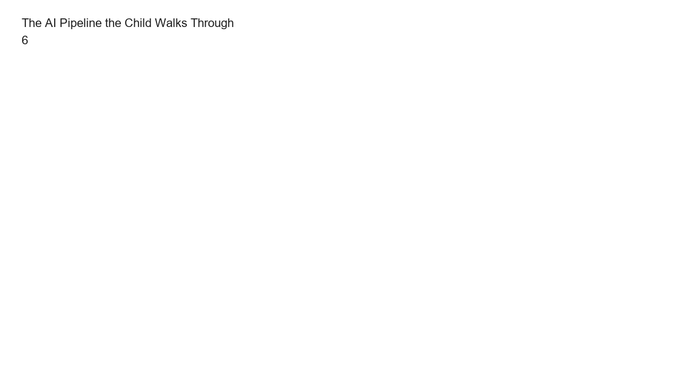 | |
| **Voice Commands** | **Why CNN?** | **Task & Data** |
|  | 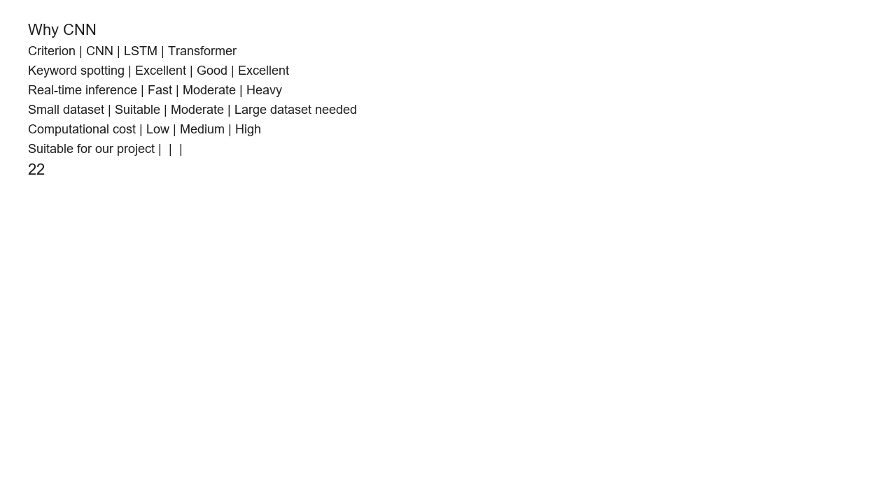 | 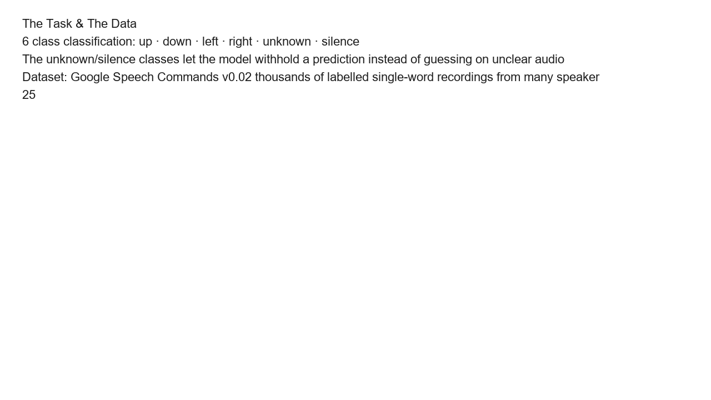 |
| **Conclusion** | | |
| 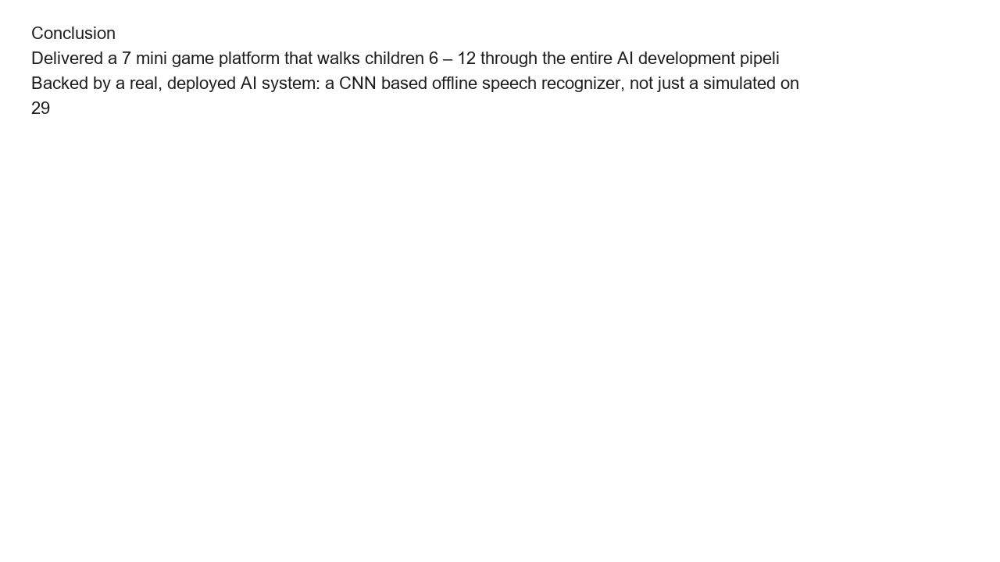 | | |

---

## 📎 Supporting Documents

- **Full presentation:** `AI tech game docs/Ai  teaching game presentation.pptx` (43 slides — architecture, methodology, requirements, results)

---

## 🚀 Running the Project

1. Open `data gathering.sln` in Unity / Visual Studio
2. Restore packages (Window → Package Manager → Restore)
3. Build for Android (File → Build Settings → Android)

---

*This repository is private. © 2026 Ranym Moussa.*